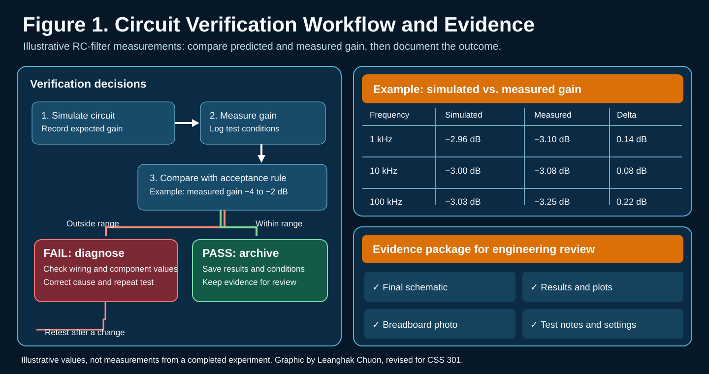

# Preparing for an Electrical Engineering Career Before Graduation

By Leanghak Chuon

© Leanghak Chuon, original technical graphic, 2026.

## Table of Contents

- [Purpose](#purpose)
- [Strengthening Technical Judgment](#strengthening-technical-judgment)
  - [Connecting Analysis With Measurements](#connecting-analysis-with-measurements)
  - [Building a Focused Design Portfolio](#building-a-focused-design-portfolio)
- [Gaining Experience Beyond Class](#gaining-experience-beyond-class)
  - [Using Projects to Practice Verification](#using-projects-to-practice-verification)
  - [Choosing Industry-Facing Opportunities](#choosing-industry-facing-opportunities)
- [Preparing for Electrical Engineering Applications](#preparing-for-electrical-engineering-applications)
  - [Documenting Decisions for Other Engineers](#documenting-decisions-for-other-engineers)
  - [Matching Evidence to Job Requirements](#matching-evidence-to-job-requirements)
- [References](#references)

## Purpose

A circuit can work in simulation and still fail during a lab test. Employers need electrical engineers who investigate differences and explain their decisions. Coursework builds your foundation, but verified projects and clear technical records show how you apply your knowledge. Use these six best practices to develop technical judgment, gain practical experience, and prepare stronger engineering applications.

## Strengthening Technical Judgment

Good design decisions depend on evidence. Measurements and project records help you explain how you reached a technical conclusion.

### Connecting Analysis With Measurements

Simulated results and physical circuits differ because of component tolerances, wiring, and measurement conditions. Investigating these differences develops the troubleshooting and testing skills associated with electrical engineering work.[^1]

**Compare simulation with measurements from a working prototype.** For an RC filter, record predicted and measured gain at several frequencies. Check your probe settings and connections before assuming a difference comes from the circuit. Save calculations, the LTspice file, and oscilloscope captures together. Include the supply voltage, equipment settings, and test conditions so another student can reproduce your results.

### Building a Focused Design Portfolio

A photo of a completed board does not explain component choices or design problems. A few documented projects provide stronger evidence of engineering decisions than a list of unfinished builds.

**Document two or three projects from design through testing.** Choose circuits, PCB layouts, or embedded hardware. Keep requirements, schematics, revisions, and measured results. Include a failed test and explain the change you made afterward. Describe tradeoffs among cost, performance, and available components when those factors affected your design.

## Gaining Experience Beyond Class

Projects and industry-facing opportunities expose you to technical feedback, deadlines, and constraints beyond routine class exercises.

### Using Projects to Practice Verification

A working prototype does not necessarily meet its design requirements. A measurable acceptance rule distinguishes a passing test from one needing further investigation.

**Define a pass condition before testing your circuit.** For example, an RC filter targeting approximately −3 dB at its cutoff frequency might use an illustrative acceptable range of −4 to −2 dB. Record simulated and measured results, then compare them with the stated limit. When a measurement falls outside the range, check wiring, component values, and the measurement setup before revising the circuit. Figure 1 adds a sample results table and an evidence checklist for documenting the outcome.

*Figure 1. Circuit verification workflow and evidence. Illustrative values, not actual test measurements. © Leanghak Chuon, 2026.*

### Choosing Industry-Facing Opportunities

Internships, supervised research, and capstones expose you to technical reviews and team decisions. UW Bothell offers capstone projects involving industry partners.[^2]

**Prioritize supervised engineering work with scheduled design reviews.** Look for an internship or capstone involving testing, troubleshooting, and feedback. When an internship is unavailable, choose a supervised project and ask an instructor or project mentor to review your results. Record the feedback, the design changes, and the follow-up test. Keep this evidence for future applications.

## Preparing for Electrical Engineering Applications

Your application should explain your contribution and connect your experience to the engineering work an employer needs.

### Documenting Decisions for Other Engineers

Another engineer needs more than a schematic to understand your design. A technical record explains requirements, tradeoffs, and test results so others can review your work.

**Write a short technical record for each major project.** State the design requirements, alternatives, test method, outcome, and limitations. Label measured values and units clearly. Ask a classmate to find missing details. Revise the record until someone unfamiliar with the project can follow the evidence without your explanation.

### Matching Evidence to Job Requirements

Electrical engineering positions vary across power, electronics, and controls.[^1] A general resume can hide experience relevant to an individual job.

**Compare three entry-level postings in your preferred field.** Match requested skills to coursework or verified project results. Describe your personal contribution and measurable outcome on your resume. Prepare to discuss one design tradeoff and one troubleshooting example in an interview.

## References

[^1]: [1] U.S. Bureau of Labor Statistics, "Electrical and Electronics Engineers," *Occupational Outlook Handbook*, n.d. [Online]. Available: https://www.bls.gov/ooh/architecture-and-engineering/electrical-and-electronics-engineers.htm. [Accessed Nov. 20, 2026].

[^2]: [2] University of Washington Bothell, "Capstones," *School of STEM*, n.d. [Online]. Available: https://www.uwb.edu/stem/industry-partners/capstones-internships. [Accessed Nov. 20, 2026].
